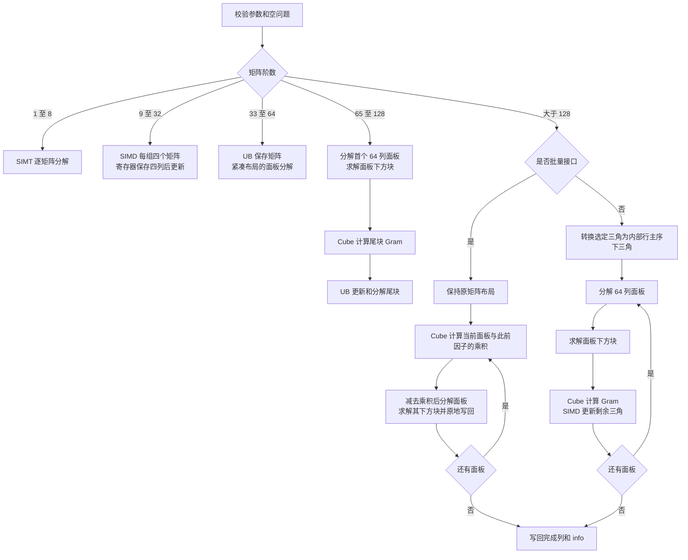
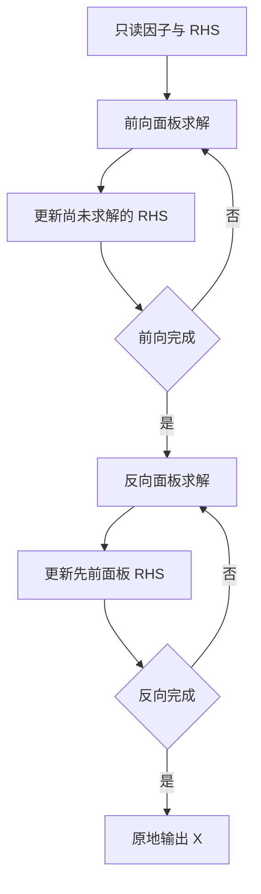

# Ascend 950 Cholesky 接口

- [单精度复数 Cholesky](#单精度复数-cholesky)：`aclsolverCpotrf/Cpotrs/Cpotri` 及批量接口。
- [单精度实数 Cholesky](#单精度实数-cholesky)：`aclsolverSpotrf/Spotrs/Spotri` 及批量接口。

两组接口共享 solver handle 和计算流，各自保持参数、info 和工作区约定。
同一 handle 的 Host 调用须串行化。句柄销毁先按复数缓冲区的同步与重试规则回收，
成功后再释放实数接口的事件缓冲池；复数回收失败时两类尚未释放的资源均保留至 Destroy 重试。

## 单精度复数 Cholesky

本文说明 Ascend950 的 C API；A2/A3 C++ 分解接口的参数及调用示例见 [Cpotrf](cpotrf.md)。

Ascend 950PR/Ascend 950DT 共用 dav-3510 / arch35 实现，构建入口均为 `--soc=ascend950`。

该实现使用公开头文件 `include/cann_ops_solver.h` 的 C ABI。
`aclsolverFloatComplex` 由两个 FP32 分量 real、imag 组成，大小为 8 字节，自然对齐为 4 字节，字段偏移为 0 和 4。
该布局与仓内 C++ 接口的 `std::complex<float>` 大小及对齐一致，公开头文件在编译期检查。
设备缓冲区可复用此存储布局；host 对象应复制分量或按值转换，不能通过无关类型解引用。
矩阵为列主序；`ACLSOLVER_FILL_MODE_LOWER=0`、`UPPER=1`。

| 接口 | 输入与输出 |
| --- | --- |
| `aclsolverCpotrf` | 读取 A 的所选三角，原地生成 L 或 U；对角虚部为零 |
| `aclsolverCpotrs` | 读取 L 或 U，保持 A 不变，原地更新 B；支持 0≤nrhs≤128 |
| `aclsolverCpotri` | 读取 L 或 U，原地生成原矩阵逆的所选三角 |
| `aclsolverCpotrfBatched` | Aarray 为设备上的指针数组，info 为逐矩阵设备数组 |
| `aclsolverCpotrsBatched` | Aarray、Barray 为设备指针数组，非空批量仅支持 nrhs=1，info 为设备标量 |

支持 0≤n≤4096、0≤batchSize≤1000000，以及非连续批量矩阵。
各维度上限独立；输入、输出和内部工作区的总量还必须满足实际可用 HBM。
合法维度组合不代表设备必有足够容量，内部工作区分配失败返回 `ACLSOLVER_STATUS_ALLOC_FAILED`。
lda/ldb 必须至少为 max(1,n)，填充区保持不变。未选择的三角不参与计算。
计算在 handle 绑定的调用方 stream 上异步执行；`nullptr` 表示 CANN 默认 stream。
同一 handle 不支持跨 Host 线程并发使用。查询、SetStream、计算和 Destroy 必须由调用方串行化；
Destroy 不能与其他线程对该 handle 的任何访问重叠，也不能继续使用已销毁的 handle。
不同 handle 可在各自合法的 CANN context 下并发使用。
同一 handle 的创建、计算和销毁须在其所属 CANN Context 中进行，不支持跨 Context 复用。

分解和求逆前分别调用 `aclsolverCpotrf_bufferSize`、`aclsolverCpotri_bufferSize`，
返回的 lwork 以复数元素计数，调用方分配 lwork×sizeof(aclsolverFloatComplex) 字节。
查询不启动设备任务。非批量求解、批量分解和批量求解的内部工作区按 handle、stream 复用；扩容保留旧缓冲区，
由 `aclsolverDestroy` 等待相关任务并释放。调用方应先销毁 handle，再销毁其 stream。
Destroy 记录首个错误并继续回收其他已确认不再使用的块；stream 同步失败时尝试 Device 同步。
不能确认已完成或释放失败的块仍由 handle 持有，不进行未同步释放。
有效 handle 在失败返回后仍由调用方持有，仅供在 Runtime 错误解除后重试 Destroy，不能继续提交计算；
已成功回收的块不会再次释放。即使块已全部回收，失败返回后也须重试以释放 Host handle。

须先检查 host 返回状态：仅当返回 SUCCESS 且 stream 成功完成后，数值 info 才有效。
分配、初始化或执行失败时 info 未定义，即使其值为 0 也不能据此判成功。
在上述成功条件下，info=0 表示成功；分解 info>0 为最早非正定主子式的一基索引，此前列已经完成；
求逆 info>0 为第一个零实部对角元素的一基索引。
非法参数返回 `ACLSOLVER_STATUS_INVALID_VALUE`，并在 handle、stream 有效且 info 可写时异步记录负参数位置，
位置不计 handle。批量分解的参数错误写入 info[0]。
空规模按接口约束成功返回；非空批量求解的 nrhs!=1 返回 info=-3。

### 批量分解的容量约束

阶数与批量上限分别约束参数，不表示二者的笛卡尔积都能在设备上执行。
非空批量分解的矩阵存储至少为 `8 * lda * n * batchSize` 字节。
当 `n<=32` 或 `n<=64 && batchSize>=16` 时不需要内部工作区；其他路径令
`p=ceil(n/16)*16`，本次工作区需求为 `8 * 130 * p * batchSize` 字节。
还须计入设备指针表、info、已有 handle 缓存、其他调用方缓冲和运行时占用；
剩余 HBM 和连续可分配空间均可能限制实际可执行规模，不能据此承诺固定的最大 batch。

例如 `n=lda=4096、batchSize=1000000` 的参数分别合法，但仅矩阵就需约 134.22 TB，
工作区另需约 4.26 TB，无法同时装入 128 GiB 的 950PR。应按实际可用容量分批提交。
内部 `aclrtMalloc` 失败返回 `ACLSOLVER_STATUS_ALLOC_FAILED` 并记录 ERROR；
此时 `info` 未定义，即使已有异步初始化将其写为 0，也不表示分解成功。

构建、实际设备测试入口见 [test/utils/cholesky/README.md](../../test/utils/cholesky/README.md)。

## 单精度实数 Cholesky

### 接口导航

本目录按照仓内 `docs/zh/<接口>.md` 的方式分别提供接口说明，
本页保留这组接口共用的算法设计与资源管理说明。

| 计算接口 | 查询接口 | 接口说明 |
|---|---|---|
| `aclsolverSpotrf` | `aclsolverSpotrf_bufferSize` | [Spotrf：Cholesky 分解](spotrf.md#ascend-950-接口) |
| `aclsolverSpotrs` | 无 | [Spotrs：基于因子求解](spotrs.md) |
| `aclsolverSpotri` | `aclsolverSpotri_bufferSize` | [Spotri：基于因子求逆](spotri.md) |
| `aclsolverSpotrfBatched` | 无 | [SpotrfBatched：指针数组批量分解](spotrf_batched.md) |
| `aclsolverSpotrsBatched` | 无 | [SpotrsBatched：指针数组批量单 RHS 求解](spotrs_batched.md) |

每份接口说明包含产品支持、功能、完整原型、参数位置和布局、返回值、约束及调用示例。

950 实现目录：`src/cholesky/arch35/`。
接口声明：[cann_ops_solver.h](../../include/cann_ops_solver.h)。
调用样例和通用测试：[test/cholesky/README.md](../../test/cholesky/README.md)。
离线依赖准备：[CATLASS](../../test/cholesky/README.md#环境和依赖)。

实现通过 C API 直接启动原生 AscendC SIMD、SIMT 和 CATLASS Cube kernel。
输入生成、CPU golden、TorchNPU 缓冲区管理只在测试程序中使用。

### 构建与目录组织

仓内[目录说明](install/dir_structure.md)允许 `src/` 下一个目录承载一类求解能力。
这五个计算接口共用面板分解、三角求解、Cube 乘积和缓冲池，统一放在
`src/cholesky/arch35/`；`arch35` 由 `--soc=ascend950` 选择。
七个公开声明统一位于 `cann_ops_solver.h`，与仓内其他接口一致。
其他受支持的 SOC 构建收集 `src/cholesky/cholesky_unsupported.cpp`，保留七个公开符号，
但不编译或链接 950 的 kernel、SIMT 库及 CATLASS 依赖。非空句柄调用返回
`ACLSOLVER_STATUS_ARCH_MISMATCH`，空句柄优先返回 `ACLSOLVER_STATUS_HANDLE_IS_NULLPTR`；
两种情况下均不访问矩阵或改写 `Lwork`、Device info 等输出。

`test/cholesky/` 沿用仓内 `${op_name}_test`、`data/gen_data.py`、
`data/verify_result.py` 三段组织方式，一个原生样例调用全部五个计算接口及两个查询接口。
`build.sh --ops` 对应测试子目录，`--ops=cholesky` 开启该测试工程；
该参数本身不筛选库的算子源码。库的源文件仍由仓内 CMake 按 SOC 收集并编译。

在仓根目录完成 [CANN 环境](install/quick_install.md)及
[CATLASS 离线准备](../../test/cholesky/README.md#环境和依赖)后执行：

```bash
# 构建公共库和这组接口的调用样例，安装到 build_out/。
bash build.sh --soc=ascend950 --ops=cholesky
# 构建并运行标准数据生成、五接口样例、LAPACK 残差验证。
bash build.sh --soc=ascend950 --ops=cholesky --run
```

每次调用 `build.sh` 都会重建 `build/`。无需按五个 C API 名分别编译，
也无需新建 `test/spotrf/` 等重复工程。
详细操作和安装产物见[测试说明](../../test/cholesky/README.md#编译运行)。

### 接口公共约定

调用程序包含 `cann_ops_solver.h`，先初始化 ACL、设置设备、创建流和 solver handle，
再调用 `aclsolverSetStream`。完整代码见 [C API 样例](../../test/cholesky/cholesky_test.cpp)。

`uplo` 类型及返回状态定义见 `cann_ops_solver_common.h`：

```cpp
typedef enum {
    ACLSOLVER_FILL_MODE_LOWER = 0,
    ACLSOLVER_FILL_MODE_UPPER = 1
} aclsolverFillMode_t;
```

| 返回值 | 含义 |
|---|---|
| `ACLSOLVER_STATUS_SUCCESS` | 查询完成或计算已提交；不代表异步数值计算一定成功 |
| `ACLSOLVER_STATUS_HANDLE_IS_NULLPTR` | 句柄为空，不写 Device info |
| `ACLSOLVER_STATUS_ARCH_MISMATCH` | 当前库为非 950 SOC 构建；不访问矩阵或改写输出 |
| `ACLSOLVER_STATUS_INVALID_VALUE` | 参数不满足对应接口约束 |
| `ACLSOLVER_STATUS_ALLOC_FAILED` | 需要内部缓冲区时资源分配失败 |
| `ACLSOLVER_STATUS_EXECUTION_FAILED` | 线程级启动错误、内部设备资源查询或事件操作失败 |

每次公开计算调用返回前通过 `aclrtPeekAtLastError(ACL_RT_THREAD_LEVEL)` 检查线程级启动错误，
它不清除调用者已有的 Runtime 错误，也不将异步计算改为同步。
返回执行失败后 info 的值不能作为计算成功依据；错误原因消除后，调用者按 CANN 约定清理线程错误。
设备异步运行错误仍须检查 `aclrtSynchronizeStream` 的返回值。
同一 handle 的 Host 调用（含计算、SetStream 和 Destroy）须由调用者外部串行化；
不同 handle 可在有效 CANN 上下文中并发使用。串行 Host 调用可以向不同流异步排队，
内部缓冲区通过事件判断是否可跨流复用；Destroy 须在所有 Host 调用返回后进行，相关流保持有效直到销毁完成。
矩阵、workspace、Device 指针数组和 info 均在 Device；只有 bufferSize 的 `Lwork`
输出在 Host。调用者须保证缓冲区与指针槽位在流完成前有效，避免并发修改同一输出。
参数错误的 info 编号不计 `handle`，以各接口说明中的顺序为准。

### 接口与存储

| 接口 | 输入与输出 | workspace |
|---|---|---|
| `aclsolverSpotrf_bufferSize` | Host 返回所需 FLOAT32 元素个数 | 查询 |
| `aclsolverSpotrf` | 原地将选定三角分解为 L 或 U | 调用者提供 |
| `aclsolverSpotrs` | 因子 A 只读，B 原地覆盖为 X | 句柄内部复用 |
| `aclsolverSpotri_bufferSize` | Host 返回所需 FLOAT32 元素个数 | 查询 |
| `aclsolverSpotri` | 将选定三角因子原地覆盖为逆矩阵同侧三角 | 调用者提供 |
| `aclsolverSpotrfBatched` | Device 指针数组，逐矩阵分解和 info | 句柄内部复用 |
| `aclsolverSpotrsBatched` | 两个 Device 指针数组，因子只读，原地求解 | 无内部 GM scratch |

FLOAT32、列主序，`A[i + j * lda]`；`lda/ldb >= max(1,n)`。
维数约束为 `0 <= n <= 4096`；单矩阵求解为 `0 <= nrhs <= 128`。
有效计算要求 n 和 nrhs 为正；n=0 或单矩阵 nrhs=0 是合法空问题。
批量求解的有效问题仅支持 `nrhs=1`，空问题约束见对应接口说明。
批量槽位可以指向非连续、独立分配的 Device 数据；各输出矩阵须相互独立。
Host 根据维数、硬件核数、可用 HBM 和内存预算选择任务划分，不读取测试用例编号。

`uplo=LOWER` 计算 `A=L Lᵀ`；`UPPER` 计算 `A=Uᵀ U`。
另一半三角不参与运算。实现保留该半三角及 leading-dimension padding；求解保留全部因子。

计算在句柄关联流上排队。调用返回成功表示已提交，读取输出和 info 前须同步该流。
单矩阵 info：成功为 0，非法参数为 `-i`；分解失败和求逆零对角为首个失败位置的 1 起始下标。
批量分解逐槽位返回 info，保留失败位置之前已经完成的分解列。
空问题按参数契约返回成功；`SpotrfBatched(batchSize=0)` 允许 infoArray 为空，
批量求解的 info 是标量，仍须提供。首个非法参数优先返回。

`Spotrf/Spotri` 的 Lwork 单位是 float 元素，使用 bufferSize 返回值分配，不能当作字节数。
分解在 `n<=64` 时无需外部 workspace；其余分解查询为 `127+2*pitch²`，
求逆为 `127+3*pitch²`，其中 `pitch=ceil(n/16)*16`。
额外 127 个元素允许在提供的空间内部对齐到 512 字节。

### 分解路径



中等矩阵仅暂存尾块乘积，避免为每个批量槽位复制两份完整矩阵。
大矩阵分解以 64 列为面板，矩阵乘积使用 FP32 Cube 并关闭 HF32。
批量大矩阵采用 left-looking 算法：只在处理当前面板时，计算它与此前已完成因子的乘积。
尚未处理的三角仍保存原输入，避免每个面板都更新和搬运整个剩余三角。
每个同时处理的矩阵只需 `pitch*64` 个 float 的乘积缓冲区。
批量任务以 persistent grid 领取槽位，不受简单按 batch 展开网格的 block 数上限影响。

### 求解和求逆

求解依次执行前向及反向三角求解。很小矩阵及大量小矩阵批量任务使用 SIMT。
9..128 阶且矩阵个数不超过硬件 Vector 核数时，各 RHS 并行执行寄存器保存 RHS 的
SIMD 路径；33..128 阶单 RHS 批量任务也使用该组件。
大矩阵先求解面板内 RHS，再更新面板外数据；
单 RHS 使用 SIMD，多 RHS 使用共享 Cube 乘积和 coalesced SIMT 减法。
四列一组的面板更新减少重复 UB 访问，尾块仍按实际宽度处理。



求逆以单位矩阵为 RHS，复用上述三角求解组件。
128 阶以下将各单位 RHS 交给同一 SIMD 求解组件；更大矩阵转换一次因子，使用 Cube 面板更新。
单线程检查首个非有限或非正对角；后续同流 kernel 观察 info，失败时不写回输入。

### 布局、资源与生命周期

分解和多 RHS 面板先累加 rank-four 乘积，再更新矩阵或 RHS；单 RHS 更新先累加
整个面板的点积，再从 RHS 中扣减。这样减少大数连续减去小乘积产生的 FP32 舍入误差，
不增加核入口或 workspace。VF 分解直接保存已算出的对角平方根；SIMT 小矩阵以 FMA
计算平方根残差并修正一次，乘减也使用融合乘加，减少因子误差向两次三角求解传播。
小矩阵三角求解保留原始 RHS，在独立寄存器中累加点积后只扣减一次，避免求逆时
单位 RHS 的对角项被反复舍入。
标准样例使用 LAPACK 残差检查；扩展测试覆盖接口契约和存储隔离。

GM stride 和地址乘积使用 64 位计算。大矩阵的单矩阵分解及求逆将选定因子打包为
行主序下三角，索引为 `row*pitch+col`；批量分解直接使用调用者的列主序布局。
内部 GM pitch 对齐 16 个 float。
UB 面板使用 72 个 float 的 stride，较宽传输缓冲区使用 136 个 float 的 stride。
16×8 FP32 转置复用带许可证的 CANNBot 模板；VF 运算采用经过验证的紧凑面板布局。
status 使用单独 DMA 读写，避免小整数通过缓存行读改写而覆盖邻接 batch info。
所有 UB 分配均低于 Ascend 950 可用 UB 容量，尾块使用有效元素掩码和 DMA 实际长度。

批量分解最多同时处理 4096 个矩阵，并限制 scratch 为 `min(8 GiB, freeHBM/8)`。
这只是分波策略，不是输入 batchSize 上限；任意批量大小仍逐槽位执行。
句柄内缓冲池按所需容量复用。相同流依赖流内顺序，不同流须等旧 event 完成才能复用。
销毁句柄等待缓冲区对应 event，随后释放；无法确认完成的异常缓冲区隔离，避免提前释放。
分解和求逆的调用者 workspace 不进入该池，用户须保证其直到本次异步计算结束都有效。

### 文件与参考

| 文件 | 职责 |
|---|---|
| `src/cholesky/arch35/cholesky_host.cpp` | 参数、workspace、分波、池生命周期与公开接口 |
| `src/cholesky/arch35/cholesky_vector.cpp` | SIMD 面板、布局转换、求解和更新 |
| `src/cholesky/arch35/cholesky_cube.cpp` | Gram 与三角求解乘积的 CATLASS 实现 |
| `src/cholesky/arch35/cholesky_simt.cpp` | SIMT 小矩阵、info、求逆与减法 |
| `src/cholesky/arch35/cholesky_internal.h` | 共享尺寸、任务参数和启动声明 |

参考 [CANNBot](https://gitcode.com/cann/cannbot-skills) 的原生开发、性能和代码审查指南，
以及 [CATLASS](https://gitcode.com/cann/catlass) 的 950 FP32 matmul 模板。
`transpose_transdata_5hd_021axis.h` 保留原始许可证及来源提交；算子流程和设计文档为本任务编写。
开发和验收使用官方 CANN 9.0.0；纯 SIMT 独立设备链接，主库和 `libcholesky_simt.so` 须一同部署。

### 批量错误与内部资源约定

SpotrsBatched 的 info 仅一个 Device 标量，不是逐矩阵数组。
已有 info 启动在计算前并行检查全部指针槽位，再由单一线程写最终值；
线程块按批量大小选取 128 至 1024 个线程，分摊长指针数组的读取；归约只遍历实际线程数。
检查使用至多 4 KiB 的块内共享内存，不增加 GM 工作区。
存在任一空 A 槽位写 -4，否则存在空 B 槽位写 -6，所有维数使用相同优先级。
此时不修改 RHS，调用者须修正指针数组后重新调用；矩阵索引不通过标量 info 返回。
该检查不复制指针数组到 Host，也不增加 kernel 种类或启动次数。

SpotrfBatched 的 Host 参数错误在 batchSize>0 且 infoArray 可写时填充全部槽位同一负码；
batchSize=0 不写任何槽位，负 batchSize 仅在 infoArray 非空时写第一个槽位。
Device 检测到空 Aarray[b] 时只写 infoArray[b]=-3，跳过该矩阵，其余有效矩阵正常分解。
这一逐槽位错误不改变成功排队的 API 返回状态；即使全部槽位为空也按逐槽位规则处理。
Aarray 本身为空则是 Host 参数错误，API 返回 INVALID_VALUE；调用者须结合返回状态和
同步后的逐项 info 区分两类错误，不能只按负码或同码槽位数量判断。
负编号对应各接口参数位置，分解的 Aarray 是第 3 个参数，求解的 Aarray 是第 4 个参数。
空槽位守卫不验证非空地址的有效性或存储重叠。
矩阵自身的数值错误仍逐槽位返回正主元编号。

池内每个原始分配额外预留 511 字节，实际工作指针对齐至 512 字节，释放时使用原始地址。
仅在新内存、事件和缓存记录全部创建成功后收缩旧容量；失败时保留可复用旧块。
所有 CATLASS 乘积使用固定版本 ElementSrc=void 的覆盖写语义（beta=0）：
首个 K tile 初始化 L0C，输出覆盖 GM，不读取旧 product。修改 epilogue 时须保留该约定。
标准契约回归另用 NaN 和非零值污染外部 workspace，验证结果不依赖旧内容。
